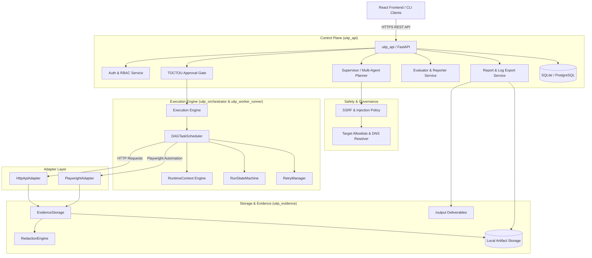
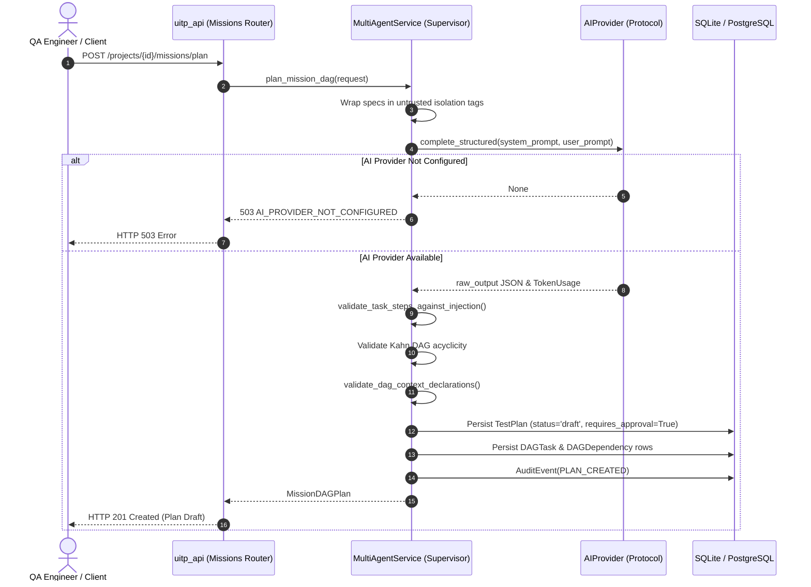
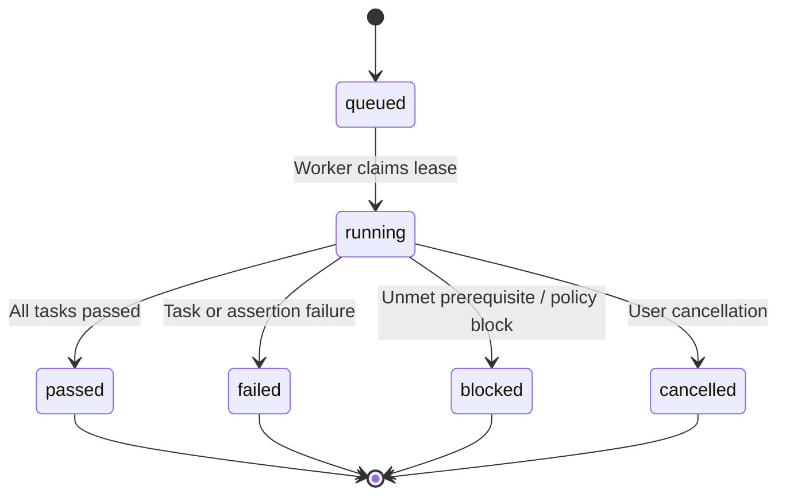
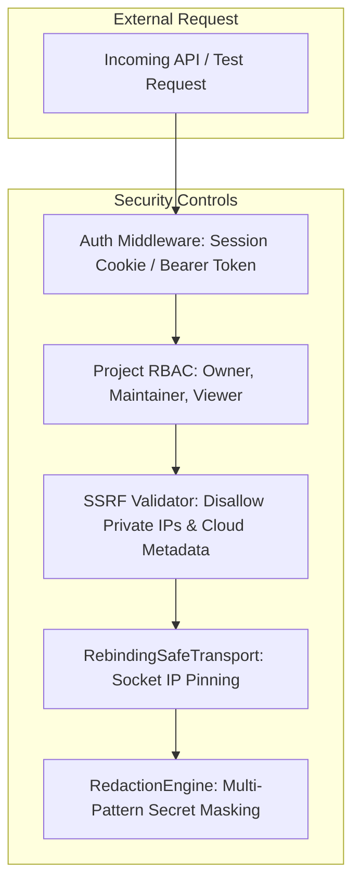

# Universal Autonomous AI Testing Platform — System Design & Architecture (DESIGN.md)

This document provides a factual, code-grounded architectural specification of the **Universal Autonomous AI Testing Platform**. Every component, interface, security boundary, and data structure described herein reflects the actual implementation in the repository as verified by tests.

---

## 1. Problem Statement & Assignment Scope

Modern software delivery requires reliable end-to-end verification spanning multiple application layers (HTTP APIs, relational stores, asynchronous jobs, and single-page browser UIs). Traditional test automation frameworks suffer from high maintenance overhead, fragile UI locators, lack of cross-layer context propagation, and brittle test suites. Conversely, naive autonomous LLM agents that execute unconstrained shell commands or dynamic scripts are unsafe, non-deterministic, leak credentials, and fail enterprise security audits.

### Scope of the Implemented System
The Universal Autonomous AI Testing Platform bridges this divide by delivering an **adapter-driven, policy-governed multi-agent test execution platform**:
- **Multi-Agent Task Planning:** An AI Supervisor/Planner decomposes high-level user specifications, requirements documents, and OpenAPI contracts into a declarative Directed Acyclic Graph (DAG) of specialized tasks.
- **Strict Human Approval Gate:** Every AI-generated plan is strictly immutable and requires explicit human review and cryptographic/audit-logged approval prior to execution.
- **Cross-Layer Runtime Context Propagation:** Downstream tasks (such as Playwright UI steps) consume outputs (such as JWT tokens or created resource IDs) from upstream API tasks via ancestor-scoped runtime context without dynamic script evaluation.
- **Deterministic Adapters:** Specialized adapters execute bounded, declarative actions (`http_api` and `web` Playwright) with explicit timeout bounds, locator validation, and assertion engines. Dynamic code execution (`eval`, `exec`, arbitrary shell) is strictly prohibited.
- **Defensive Multi-Tenant Security:** Full tenant isolation, application-layer and network-layer SSRF prevention, DNS rebinding TOCTOU protection, zero plaintext secret persistence, and centralized payload redaction.
- **Evidence-Based Deliverables:** Authoritative generation of `/output/execution_log.json`, `/output/report.md`, and failure screenshots directly from persisted database execution records.

---

## 2. High-Level Architecture & Module Responsibilities

The system is organized as a modular Python monorepo (`backend/`) with a TypeScript React frontend (`frontend/`). UI components interact solely through the REST API, and workers communicate strictly via persistent database state and queued messages.



### Module Responsibilities

| Package / Module | Responsibility | Primary Callers | Primary Dependencies | Status |
|---|---|---|---|---|
| [`uitp_contracts`](file:///E:/Test%20Agent/backend/packages/contracts/src/uitp_contracts/) | Shared Pydantic data schemas defining plans, steps, DAG tasks, context exports, runs, evidence, and export deliverables. | All backend modules & frontend type generation. | `pydantic` | **Implemented & Tested** |
| [`uitp_policy`](file:///E:/Test%20Agent/backend/packages/policy/src/uitp_policy/) | Enforces SSRF defenses, target allowlists, IP literal prohibitions, DNS rebinding socket pinning (`RebindingSafeTransport`), and execution limits. | `uitp_api`, `HttpApiAdapter`, `PlaywrightAdapter`. | Standard library, `dnspython`, `ipaddress` | **Implemented & Tested** |
| [`uitp_orchestrator`](file:///E:/Test%20Agent/backend/packages/orchestrator/src/uitp_orchestrator/) | DAG task scheduler (`DAGTaskScheduler`), state machine transitions (`RunStateMachine`), bounded retry policies (`RetryManager`), and ephemeral run context (`RuntimeContext`). | `run_service`, `uitp_worker_runner`. | `uitp_contracts` | **Implemented & Tested** |
| [`uitp_adapter_http_api`](file:///E:/Test%20Agent/backend/packages/adapters/http_api/src/uitp_adapter_http_api/) | Executes bounded declarative HTTP requests, evaluates status/JSONPath/header/schema assertions (`HttpAssertionEngine`), and sanitizes headers. | `run_service`, `uitp_worker_runner`. | `httpx`, `uitp_policy`, `uitp_evidence` | **Implemented & Tested** |
| [`uitp_adapter_web`](file:///E:/Test%20Agent/backend/packages/adapters/web/src/uitp_adapter_web/) | Executes declarative browser automation (navigate, click, fill, select, assert visible) in isolated browser contexts with network routing SSRF protection (`BrowserSecurityRouter`). | `run_service`, `uitp_worker_runner`. | `playwright`, `uitp_policy`, `uitp_evidence` | **Implemented & Tested** |
| [`uitp_evidence`](file:///E:/Test%20Agent/backend/packages/evidence/src/uitp_evidence/) | Atomic artifact storage (`LocalFilesystemEvidenceStorage`), SHA-256 integrity verification, path traversal protection, and payload redaction (`RedactionEngine`). | Adapters, `evidence_service`, `report_export_service`. | Standard library, `hashlib` | **Implemented & Tested** |
| [`uitp_api`](file:///E:/Test%20Agent/backend/api/src/uitp_api/) | FastAPI REST service providing authentication, project/environment management, AI plan generation, approval workflows, run orchestration, and audit event tracking. | Frontend UI, CI pipelines, CLI clients. | SQLAlchemy, FastAPI, Pydantic | **Implemented & Tested** |
| [`uitp_worker_runner`](file:///E:/Test%20Agent/backend/workers/runner/src/uitp_worker_runner/) | Asynchronous worker process executing test runs, tracking step attempts, enforcing storage quotas, and managing execution leases. | Redis / RQ worker queue. | RQ, SQLAlchemy, `uitp_orchestrator` | **Implemented & Tested** |

---

## 3. Input Ingestion Architecture

The platform supports multi-source input ingestion to construct comprehensive multi-agent testing missions:

```
                  ┌──────────────────────┐
                  │   requirements.md    │ (Markdown Specs / User Stories)
                  └──────────┬───────────┘
                             │
                  ┌──────────▼───────────┐
                  │     openapi.json     │ (API Definitions / Endpoints)
                  └──────────┬───────────┘
                             │
                  ┌──────────▼───────────┐
                  │    scenarios.json    │ (Acceptance Scenarios / Criteria)
                  └──────────┬───────────┘
                             │
                  ┌──────────▼───────────┐
                  │ Target App Base URLs │ (Allowed Environments)
                  └──────────┬───────────┘
                             │
                             ▼
         [POST /api/v1/projects/{project_id}/missions/plan]
```

### Ingestion Contract: `MultiAgentMissionRequest`
Defined in [`backend/packages/contracts/src/uitp_contracts/plan.py`](file:///E:/Test%20Agent/backend/packages/contracts/src/uitp_contracts/plan.py):
- `requirements_content` (str, 1B–64KB): Business logic specifications, acceptance criteria, or functional requirements.
- `openapi_spec` (str, optional, up to 256KB): Complete OpenAPI 3.0/3.1 JSON or YAML specification defining endpoints, request bodies, and expected response schemas.
- `scenarios_content` (str, optional, up to 64KB): Specific test scenario outlines or edge cases.
- `target_urls` (list[str]): Application URLs to validate against the target environment allowlist.
- `environment_id` (str): Unique identifier of the pre-configured project environment containing base URLs, target allowlists, and masked secret references.
- `max_parallel_tasks` (int, default 4, bounds 1–10): Concurrency limit for parallel DAG execution.

---

## 4. Planner/Supervisor & LLM Provider Boundary

The multi-agent planning process is orchestrated by `multi_agent_service.plan_mission_dag` in [`backend/api/src/uitp_api/services/multi_agent_service.py`](file:///E:/Test%20Agent/backend/api/src/uitp_api/services/multi_agent_service.py).



### The `AIProvider` Protocol Boundary
Implemented in [`backend/api/src/uitp_api/services/ai_provider.py`](file:///E:/Test%20Agent/backend/api/src/uitp_api/services/ai_provider.py):
- **Vendor Agnostic:** Implements `complete_structured(*, system_prompt, user_prompt, temperature)` returning typed data and token usage metrics.
- **Implementations:**
  - `MockAIProvider`: Used in automated test suites and offline CI to generate deterministic, predictable DAG plans without external network dependencies.
  - `HttpOpenAICompatibleProvider`: Communicates with any OpenAI-compatible API endpoint (OpenAI, Azure, vLLM, Ollama) enforcing strict timeouts and token budgets.
- **Graceful Degradation:** If no provider is configured (`UITP_AI_PROVIDER` unset), the endpoint raises `503 AI_PROVIDER_NOT_CONFIGURED`. Manual plan creation and test execution remain fully functional.

---

## 5. Structured Output Validation, Prompt-Injection Defenses & Approval Flow

### Prompt-Injection Defense Architecture
To prevent malicious specifications or manipulated OpenAPI descriptions from hijacking the supervisor:
1. **Untrusted Prompt Encapsulation:** All user inputs are encapsulated within explicit delimiter boundaries:
   ```xml
   <untrusted_user_intent>
   ... user requirements ...
   </untrusted_user_intent>
   <untrusted_spec>
   ... openapi spec ...
   </untrusted_spec>
   ```
2. **Deterministic Post-Generation Validation Gate:** Model output is treated as untrusted data. The validator [`validate_task_steps_against_injection`](file:///E:/Test%20Agent/backend/api/src/uitp_api/services/multi_agent_service.py#L42-L65) inspects all steps:
   - Prohibits executable tokens: `eval`, `exec`, `subprocess`, `os.system`, `child_process`, `import`, `sh`, `bash`, `powershell`.
   - Rejects unallowlisted actions or malformed parameters.
   - Any violating plan is rejected with `422 VALIDATION_ERROR`.
3. **DAG Topology Validation:** Evaluates task dependencies using Kahn's topological sorting algorithm. Cyclic dependencies are strictly rejected (`422 VALIDATION_ERROR`).

### Mandatory TOCTOU Approval Gate
- Every AI-generated plan is saved with `status="draft"` and `requires_approval=True`.
- Attempting to execute an unapproved or draft plan via `POST /api/v1/plans/{id}/runs` fails with `422 PLAN_NOT_APPROVED`.
- Approval requires an explicit call to `POST /api/v1/missions/{mission_id}/approve` by an authenticated user with `owner` or `maintainer` role.
- Approved plans are cryptographically immutable: any subsequent edit automatically branches a new draft version (ADR-015).

---

## 6. DAG Representation, Dependency Edges, Scheduling & Failure Propagation

Multi-agent plans are represented as a directed graph where nodes are tasks and directed edges represent strict prerequisite dependencies.

### Database Persistence Model
Defined in [`backend/api/src/uitp_api/models/dag.py`](file:///E:/Test%20Agent/backend/api/src/uitp_api/models/dag.py):
- `DAGTask`: Task node (`task_id`, `name`, `assigned_role`, `adapter_type`, `steps`, `exports`, `requirement_refs`).
- `DAGDependency`: Directed edge (`parent_task_id` -> `child_task_id`).
- `DAGTaskAttempt`: Records task attempt lifecycle (`pending`, `running`, `passed`, `failed`, `blocked`), timestamps, and error diagnostics.

### Scheduling Engine (`DAGTaskScheduler`)
Implemented in [`backend/packages/orchestrator/src/uitp_orchestrator/dag_scheduler.py`](file:///E:/Test%20Agent/backend/packages/orchestrator/src/uitp_orchestrator/dag_scheduler.py):
- **Ready Task Resolution:** A task enters the `READY` pool if and only if all of its `depends_on` parent tasks have completed with `status="passed"`.
- **Concurrency Bounding:** The scheduler dispatches independent ready tasks up to `max_parallel_tasks`.
- **Cascading Failure Block:** When any task fails, the scheduler calls `mark_task_failed(task_id)` which traverses the downstream dependency subgraph using Breadth-First Search (BFS) and immediately transitions all dependent children to `BLOCKED`. Blocked tasks record:
  ```
  Prerequisite task '<parent_task_id>' failed: <parent_error_diagnostic>
  ```
  Downstream tasks are never scheduled, preventing wasted executions and partial state corruptions.

---

## 7. Adapter Layer: API and UI Specialist Contracts

The platform strictly isolates adapter execution behind the `BaseAdapter` contract ([`uitp_adapter_base/base.py`](file:///E:/Test%20Agent/backend/packages/adapters/base/src/uitp_adapter_base/base.py)). Adapters are stateless workers that execute single declarative steps and return structured outcomes.

```
       ┌────────────────────────┐
       │   TestStepSchema       │
       │   - action             │
       │   - inputs             │
       │   - assertions         │
       └───────────┬────────────┘
                   │
                   ▼
       ┌────────────────────────┐
       │      BaseAdapter       │
       │  + execute_step()      │
       └─────┬────────────┬─────┘
             │            │
             ▼            ▼
     ┌───────────────┐  ┌──────────────────┐
     │ HttpApiAdapter│  │ PlaywrightAdapter│
     └───────────────┘  └──────────────────┘
```

### 1. HTTP API Adapter (`HttpApiAdapter`)
- **Supported Actions:** `get`, `post`, `put`, `patch`, `delete`.
- **SSRF Defense Gate:** Evaluates target URLs against the environment allowlist and verifies the destination IP literal is not in loopback, private, link-local, or cloud metadata ranges (`169.254.169.254`).
- **Assertion Engine (`HttpAssertionEngine`):** Deterministically evaluates:
  - `status_code`: Exact HTTP response code match.
  - `json_path_equals`, `json_path_exists`, `json_path_matches`: Safe JSONPath extraction without Python `eval`.
  - `header_equals`, `header_exists`: Case-insensitive header checks.
  - `schema_match`: Draft-07 JSON Schema validation against response payloads.

### 2. Web Adapter (`PlaywrightAdapter`)
- **Supported Actions:** `navigate`, `click`, `fill`, `select`, `wait_for`, `screenshot`.
- **Security Routing (`BrowserSecurityRouter`):** Intercepts browser requests using `context.route("**/*")`. Blocks navigations and resource fetches to non-allowlisted domains, private IP literals, and cloud metadata endpoints. Aborts unauthorized popups and file downloads.
- **Declarative Locators (`WebLocatorParser`):** Supports `css`, `text`, `test_id`, `role`, `label`, `placeholder`. Explicitly rejects selector injection tokens (`javascript:`, `eval(...)`, dynamic scripts).
- **Failure Screenshots:** Automatically captures full-page screenshot bytes upon assertion failure or explicit `screenshot` action and transfers them to `EvidenceStorage`.

---

## 8. Cross-Layer Runtime Context Propagation

Implemented in [`backend/packages/orchestrator/src/uitp_orchestrator/context.py`](file:///E:/Test%20Agent/backend/packages/orchestrator/src/uitp_orchestrator/context.py) per ADR-017:

```mermaid
graph LR
    subgraph "Producer Task: auth_task (API Specialist)"
        A1[Step: POST /auth/login] --> A2[Output: token = jwt-token-123]
        A2 -->|Extract JSONPath '$.token'| A3[Export: auth_token is_secret=True]
    end

    subgraph "RuntimeContext (Run-Scoped, Ephemeral)"
        A3 -->|Publish on Task Success| CtxStore[Memory Context Store]
        CtxStore -.->|Persist Redacted| DB[(run_contexts: value='[REDACTED]')]
    end

    subgraph "Consumer Task: ui_profile (UI Specialist)"
        CtxStore -->|Validate Ancestor Dependency & Inject| B1[Resolve: Bearer ${context.auth_token}]
        B1 --> B2[Step: navigate /profile with Auth Header]
    end
```

### Context Security Invariants
1. **Run Scoped:** Initialized per execution run. State is never shared across runs, tenants, or missions.
2. **Ancestor-Only Scoping:** Tasks may only resolve keys exported by their direct or transitive dependencies (ancestors). Unlinked sibling tasks cannot observe or overwrite each other's keys (`DisallowedContextReferenceError`).
3. **Strict Expression Grammar:** Restricted to `${context.<var_name>}`. Dynamic arithmetic, expressions, and string concatenation engines are rejected (`InvalidContextExpressionError`).
4. **Pre-Dispatch Validation:** Missing context keys, invalid syntax, and non-scalar interpolation types are validated before adapter invocation.
5. **Secret Redaction:** Variables declared with `is_secret=True` are persisted to the database `run_contexts` table strictly as `"[REDACTED]"`. Unredacted values exist only in memory during execution and are scrubbed from evidence artifacts and timeline events.

---

## 9. Run and Task State Machines, Persistence & Idempotency

### State Machine Lifecycle
The system state transitions are governed by `RunStateMachine` ([`uitp_orchestrator/state_machine.py`](file:///E:/Test%20Agent/backend/packages/orchestrator/src/uitp_orchestrator/state_machine.py)):



### Idempotency & Worker Leases
- **Run Creation Idempotency:** The `POST /plans/{id}/runs` endpoint respects the `Idempotency-Key` HTTP header. Duplicate requests within a 24-hour window return the existing run record without executing duplicate steps (P3-03).
- **Worker Leases & Heartbeats:** When an asynchronous worker claims a run, it acquires a lease (`lease_expires_at`). Workers send periodic heartbeats via `POST /api/v1/runs/{run_id}/heartbeat`. Stale or crashed workers are detected and recovered by `run_service.recover_stale_runs()`, transitioning stuck runs to `failed`.

---

## 10. Inter-Agent Communication & Adapter Contracts

In strict compliance with architectural rules:
- **No Shared Process Memory:** Agents do not communicate via shared global variables or direct inter-process sockets.
- **Database & Queue Boundary:** Inter-agent orchestration is conducted via persistent database records (`TestPlan`, `DAGTask`, `DAGDependency`, `DAGTaskAttempt`, `RunEvent`) and queued jobs.
- **Typed Input/Output Payloads:** Adapters receive `ExecutionContext` and `TestStepSchema` and produce immutable `StepExecutionResult` containing status codes, headers, sanitized outputs, and assertion reports.

---

## 11. Retry, Timeout, Cancellation, Malformed Output & Recovery Behavior

### 1. Bounded Retry Engine (`RetryManager`)
Implemented in [`backend/packages/orchestrator/src/uitp_orchestrator/retry.py`](file:///E:/Test%20Agent/backend/packages/orchestrator/src/uitp_orchestrator/retry.py):
- **Idempotency Class Enforcement:**
  - `safe` (e.g. HTTP GET): Retried up to configured `max_attempts` with exponential backoff and jitter.
  - `idempotent` (e.g. HTTP PUT/DELETE with idempotency key): Retried up to limit.
  - `non_idempotent` (e.g. HTTP POST without unique idempotency key): **Never retried automatically**. Returns failure after attempt 1 to prevent duplicate payments or resource creations.
- **Terminal Errors:** Policy blocks, authentication failures (401), and permission denials (403) are never retried.

### 2. Multi-Level Timeouts
- **Step Timeout:** Enforced per action (default 30s).
- **Task Timeout:** Enforced per DAG node (default 60s).
- **Run Wall-Clock Timeout:** Total run execution hard limit (default 300s).

### 3. Graceful Cancellation
Calling `POST /api/v1/runs/{run_id}/cancel` validates terminal conflicts (409) and flags the run as `cancelled`. Workers evaluate cancellation status between step iterations, aborting pending steps cleanly and freeing browser resources in `finally` blocks.

---

## 12. Test Selection Strategy: Implemented vs. Planned

To maintain absolute documentation integrity:

| Feature / Capability | Description | Current Status |
|---|---|---|
| **Multi-Agent DAG Execution** | Parallel DAG task dispatch, dependency tracking, failure cascade. | **Implemented & Verified** |
| **Cross-Layer Context** | Export extraction, ancestor scoping, secret masking, JSONPath resolution. | **Implemented & Verified** |
| **Evidence & Deliverable Export** | Atomic generation of `/output/execution_log.json` and `/output/report.md`. | **Implemented & Verified** |
| **Deterministic HTTP Adapter** | Status, JSONPath, header, schema assertions, bounded payload size. | **Implemented & Verified** |
| **Playwright Web Adapter** | Safe locators, browser SSRF routing, visibility assertions, failure screenshot capture. | **Implemented & Verified** |
| **Dynamic Smoke/Regression Selection** | Automatic test subset selection based on Git diffs or impact analysis tags. | **Planned (Milestone 2+ / Future)** |
| **Mobile & Desktop Adapters** | Appium / App-specific desktop OS runner adapters (L-01, L-02). | **Planned (Future Extensibility)** |
| **Kernel-Level Egress Filtering** | iptables / cloud security group packet blocking independent of application code (P3-07). | **Partially Implemented (App-layer complete; network-layer planned)** |

---

## 13. Evaluator, Requirement Traceability & Root-Cause Analysis (RCA)

Implemented in [`multi_agent_service.generate_mission_evaluation`](file:///E:/Test%20Agent/backend/api/src/uitp_api/services/multi_agent_service.py#L330-L397):
- **Traceability Matrix:** Maps requirements declared in `DAGTask.requirement_refs` to actual task execution outcomes:
  - `PASSED`: All verifying tasks passed.
  - `FAILED`: One or more verifying tasks failed.
  - `BLOCKED`: Verifying tasks were blocked by upstream failures.
  - `UNTESTED`: Tasks were never scheduled or run was cancelled midway.
- **Grounded Root-Cause Diagnostics:** Diagnostics are derived strictly from concrete failed assertions, HTTP status codes, schema error paths, or captured exception traces.
- **RCA Boundary & Anti-Hallucination:** If telemetry is missing or execution ended prematurely, the report explicitly outputs `[INSUFFICIENT_EVIDENCE]` rather than inventing plausible-sounding causes.

---

## 14. Artifact Storage & Deliverables Architecture

### Deliverable File Locations
Exports are managed by [`report_export_service`](file:///E:/Test%20Agent/backend/api/src/uitp_api/services/report_export_service.py) per ADR-018:
- **Assignment Deliverables Root:**
  - `/output/execution_log.json`: Versioned (v1.0) JSON log validated against `ExecutionLogSchema`.
  - `/output/report.md`: Grounded Markdown report with executive summary, traceability matrix, step details, and failure diagnostics.
  - `/output/evidence/`: Directory containing failure screenshots and response logs.
- **Per-Run Historical Archive:**
  - `/output/runs/{run_id}/execution_log.json`
  - `/output/runs/{run_id}/report.md`
  - `/output/runs/{run_id}/evidence/{artifact_id}.png`

### Integrity & Security Controls
1. **Atomic Writes:** Files are written to `<path>.tmp.<uuid>`, flushed, and fsynced before atomic replacement (`os.replace`). Exporter crashes never leave corrupted files.
2. **Path Traversal Defense:** Storage keys are strictly validated against directory escape components (`..`, `~`, `:`).
3. **Collision Safety:** Distinct runs write to distinct per-run folders, eliminating overwrite races during concurrent test runs.

---

## 15. Authentication, Tenant Isolation, SSRF & Secret Redaction



### Threat Boundary Summary
- **Tenant Isolation:** Cross-project requests return HTTP 404 (`ResourceNotFoundError`) rather than 403 to prevent project ID enumeration.
- **SSRF Defenses:** Validates all target URLs against allowlists. Rejects loopback (`127.0.0.0/8`), private (`10.0.0.0/8`, `172.16.0.0/12`, `192.168.0.0/16`), link-local (`169.254.0.0/16`), and cloud metadata services (`169.254.169.254`, `metadata.google.internal`).
- **DNS Rebinding Defense (`RebindingSafeTransport`):** Resolves target hostnames before socket connection and pins the outbound TCP connection directly to the pre-validated IP address, eliminating TOCTOU DNS rebinding windows.
- **Secret Redaction:** Centralized regex and key pattern scrubber masks authorization headers, JWT tokens, session cookies, passwords, and secret context exports across all database rows, response logs, timeline events, and export deliverables.

---

## 16. Local Development & Single-Command Startup

The platform supports immediate local development without requiring external Docker containers or paid cloud services.

### Single-Command Startup
Using the repository `Makefile`:
```powershell
# 1. Install dependencies
make install

# 2. Run database migrations
make migrate

# 3. Start local development API server (runs on http://localhost:8000)
make dev
```

### Running Offline Development Mode
SQLite is automatically initialized at `./uitp_dev.db` when running locally without Docker. Test suites operate in-memory (`sqlite+aiosqlite:///:memory:`) for high-speed, fully isolated execution.

---

## 17. Test Strategy & How to Reproduce an End-to-End Mission

### Running the Automated Test Suites
Execute the verified test suites via pytest:

```powershell
# Run the complete multi-agent DAG, context, and export test suites:
.venv\Scripts\python.exe -m pytest tests/unit/test_dag_scheduler.py tests/unit/test_runtime_context.py tests/unit/test_report_export_service.py tests/integration/test_multi_agent_missions.py tests/integration/test_dag_context_propagation.py tests/integration/test_report_and_log_export.py -v
```

### Reproducing an End-to-End Mission via REST API
To execute a genuine multi-agent mission from scratch:

1. **Register and Authenticate:**
   ```bash
   curl -X POST http://localhost:8000/api/v1/auth/register \
     -H "Content-Type: application/json" \
     -d '{"email":"qa@example.com","password":"secure-password-123"}'
   
   curl -X POST http://localhost:8000/api/v1/auth/login \
     -H "Content-Type: application/json" \
     -d '{"email":"qa@example.com","password":"secure-password-123"}' \
     -c cookies.txt
   ```

2. **Create Project and Environment:**
   ```bash
   curl -X POST http://localhost:8000/api/v1/projects \
     -H "Content-Type: application/json" -b cookies.txt \
     -d '{"name":"Autonomous QA Mission"}'
   
   curl -X POST http://localhost:8000/api/v1/projects/{project_id}/environments \
     -H "Content-Type: application/json" -b cookies.txt \
     -d '{"name":"Local Dev","base_url":"http://localhost:8000","allowlist":["localhost"]}'
   ```

3. **Plan Mission (Supervisor Agent):**
   ```bash
   curl -X POST http://localhost:8000/api/v1/projects/{project_id}/missions/plan \
     -H "Content-Type: application/json" -b cookies.txt \
     -d '{
       "requirements_content": "# Auth & Profile\n1. POST /login\n2. GET /profile with auth token",
       "environment_id": "{environment_id}"
     }'
   ```

4. **Approve Mission Plan (Human-in-the-Loop Gate):**
   ```bash
   curl -X POST http://localhost:8000/api/v1/missions/{mission_id}/approve \
     -H "Content-Type: application/json" -b cookies.txt \
     -d '{"comment":"Approved after graph inspection"}'
   ```

5. **Execute Mission Run:**
   ```bash
   curl -X POST http://localhost:8000/api/v1/plans/{mission_id}/runs \
     -H "Content-Type: application/json" -b cookies.txt \
     -d '{"environment_id":"{environment_id}"}'
   ```

6. **Inspect Deliverables:**
   ```bash
   # Download generated Markdown report
   curl http://localhost:8000/api/v1/runs/{run_id}/export/report -b cookies.txt
   
   # Download generated Execution Log JSON
   curl http://localhost:8000/api/v1/runs/{run_id}/export/log -b cookies.txt
   ```
   Deliverable files are also directly accessible on disk at `/output/execution_log.json` and `/output/report.md`.

---

## 18. Known Limitations & Future Work

1. **Kernel-Level Network Egress Enforcement (P3-07):**
   - *Current State:* Strict application-level SSRF validation, URL allowlisting, and DNS socket pinning (`RebindingSafeTransport`) are active and verified.
   - *Future Work:* Independent container egress packet filtering (e.g. iptables rules blocking RFC1918 subnets at the Linux bridge level) prior to multi-tenant cloud hosting.
2. **Dynamic Test Selection (Smoke vs. Full Regression):**
   - *Current State:* Full mission DAG plans execute all planned tasks with topological concurrency.
   - *Future Work:* Impact-analysis engine to dynamically select a smoke subset versus a full regression graph based on code diffs or commit metadata.
3. **Model-Assisted Failure Summaries (P5-05):**
   - *Current State:* Evaluator synthesizes deterministic requirement matrices and assertion diagnostics grounded in database records.
   - *Future Work:* Optional second-pass LLM failure explanation prompt constrained to sanitized error excerpts.
4. **Third-Party Adapters (L-01 – L-06):**
   - Mobile (Appium), desktop GUI, and database query adapters remain planned extensibility milestones beyond the core HTTP API and Playwright Web adapters.
